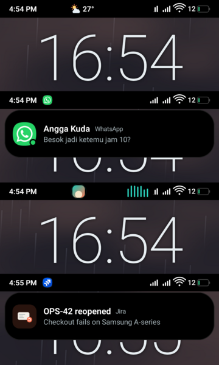
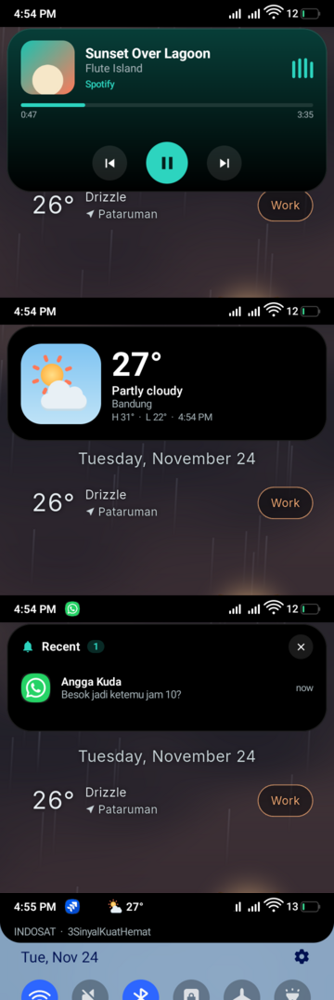
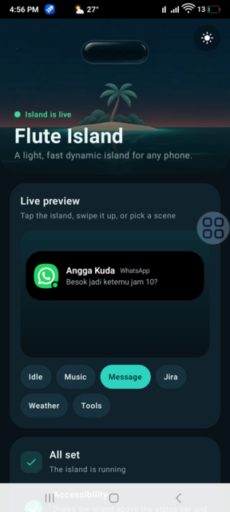

# Flute Island

[](https://github.com/igun997/flute-island/actions/workflows/release.yml)

A light, fast **dynamic island** for Android. It hugs the front-camera cut-out, shows notifications, music, weather
and Jira tickets, and gets out of the way in games and fullscreen apps. Built to look good and stay cheap on
low-end phones (developed and tested on a Samsung Galaxy A22: Android 13, 720x1600).

<p>
  
  
  
</p>

## Contents

- [Features](#features)
- [Install](#install)
- [Using it](#using-it)
- [Permissions and privacy](#permissions-and-privacy)
- [How it works](#how-it-works)
- [Jira sign-in](#jira-sign-in)
- [Development](#development)
- [Releases](#releases)
- [Troubleshooting](#troubleshooting)
- [Repository layout](#repository-layout)

## Features

| | |
|---|---|
| **Notifications** | WhatsApp (own accent), Telegram and every other app, per-app on/off. *Take over* clears the original from the shade once the island showed it (tapping the island still opens the right chat). *Every app uses the island* ignores the block list: quiet notifications go straight to Recent, and only live controls (calls, players, downloads) stay in the shade. |
| **No double notifications** | Samsung shows its own pop-up about 1.5 s after a notification, even a cancelled one. The island swipes that pop-up away (switch: *Hide the original pop-up too*). |
| **Now playing** | Spotify and any media session: album art, equalizer, progress, previous / play-pause / next. |
| **Weather** | Open-Meteo (no API key). Icon and temperature next to the camera, an animated panel on tap, city search. |
| **Tools mode** | Polls Jira and pops up a ticket the moment it is reopened; the panel lists them, one tap opens the ticket. |
| **Cover the status bar** | Optional. The island draws its own black bar over the system one (clock, wifi, signal per SIM, battery) and merges with it: roomier slots, a 7-bar equalizer, a pulsing album ring, and the icons of apps with something waiting in Recent. It ignores touches, so a swipe down pulls the shade as usual; with the shade open it grows, rounds its corners and shows each SIM's carrier. |
| **Stay out of the way** | Hidden (alerts held, stale ones dropped) while a game or any fullscreen app is in front. |
| **Theme** | Follows dark/light, or flip it with the sun/moon button (long-press = back to auto). The compact pill stays black so it merges with the lens. |
| **Self-healing** | If the app ever crashes, Android marks the accessibility service as crashed and never restarts it. The control room then says *Island stopped*, shows the reason and offers a restart; with one optional permission the app restarts itself. |
| **Control room** | Fluid Compose UI: live preview of the real island, setup checklist, gestures, mode, alerts, status bar, weather, Jira, look and feel. A first-run Lottie intro plays once. |

## Install

1. Download `flute-island-<version>.apk` from [Releases](https://github.com/igun997/flute-island/releases) and check it
   against `SHA256SUMS.txt`. It needs Android 8.0 (API 26) or newer.
2. Open it and allow installing from your browser or file manager.
3. Open **Flute Island** and follow the setup checklist. Two switches make the island work:
   * **Accessibility** draws the island above the status bar. On Android 13+ a sideloaded app is greyed out until you
     open *App info > ⋮ > Allow restricted settings*; the control room has a button for it.
   * **Notification access** lets it read WhatsApp, Spotify and other alerts.
4. Optional, in the control room: *Allow phone state* (signal for each SIM in the cover bar) and *Battery settings*
   (exempt it from optimisation if your phone kills background apps).

Optional, for automatic recovery after a crash, run once on a computer:

```sh
adb shell pm grant dev.igun997.fluteisland android.permission.WRITE_SECURE_SETTINGS
```

Updating keeps your settings as long as the APK is signed with the same key (every release is).

## Using it

| Gesture | Does |
|---|---|
| Tap | Open the panel (music, Recent, weather, Jira) or the alert's app |
| Hold | Open the control room (a line fills along the pill while you hold) |
| Swipe left / right | Next panel |
| Swipe up | Close a panel or dismiss an alert |
| Swipe down (cover on) | Pull the shade |

## Permissions and privacy

| Permission | Why |
|---|---|
| Accessibility service | The only window type Android draws above the status bar *and* sends touches to. |
| Notification access | Reads notifications and media sessions to show them; clears the originals when take-over is on. |
| Internet | Weather (Open-Meteo) and Jira. |
| Phone state (optional) | Signal strength and carrier name of each SIM for the cover bar. |
| `WRITE_SECURE_SETTINGS` (optional, adb only) | Lets the app switch its own accessibility service off and on to recover from a crash. |

The accessibility service asks for little: window-change events, window geometry, the package name of the foreground
app and of system windows, and one injected gesture (swiping away the system's own pop-up of a notification the island
already took over). It never reads text or anything else drawn inside a window. Jira credentials are stored encrypted
with the Android Keystore; the OAuth client secret never touches the phone (see below).

The system status bar itself cannot be hidden or replaced by a normal app (that needs root); the cover bar is a black,
non-touchable overlay on top of it.

## How it works

```
core/        pure Kotlin: IslandController (state machine), NotificationMapper, Weather/Jira/OAuth parsers   <- unit tested
data/        SettingsStore, Secrets (Keystore AES-GCM), Http, WeatherRepo, JiraSession, CrashGuard
service/     IslandAccessibilityService (host) + OverlayHost and CoverHost, IslandListenerService, MediaWatcher,
             StatusIndicators, Repair, Weather/Jira engines
ui/island    IslandSurface and its content: one pill whose size springs between states; StatusCover bar
ui/control   the control room
backend/     jira-auth-proxy: a Cloudflare Worker that keeps the Atlassian client secret off the phone
```

`IslandAccessibilityService` hosts one persistent overlay window; `IslandListenerService` feeds it notifications and
media. Settings flow into a pure controller that decides what the island shows, and `OverlayHost` sizes the window.

Performance choices: idle costs zero frames; one spring animates the pill while content is laid out at its final size
and revealed; the always-visible equalizer is a 30 fps canvas, not a looping Lottie (measured median frame 10 ms vs
24 ms); the overlay window is only as big as the pill (so it never swallows touches), is enlarged *before* a grow and
trimmed *after* a shrink settles, and is always centred on the camera so nothing slides sideways.

## Jira sign-in

Atlassian's OAuth needs a client secret to redeem a code, and an app cannot keep a secret, so
[`backend/jira-auth-proxy`](backend/jira-auth-proxy/README.md) keeps it. One-time setup is in that README; then put the
client id and the worker URL in `gradle.properties` (`fluteJiraClientId`, `fluteJiraAuthProxy`). Until then the app
offers a manual API-token sign-in.

## Development

Requirements: JDK 17+ and the Android SDK (compileSdk 35). The Gradle wrapper is included.

```sh
./gradlew testDebugUnitTest                  # unit tests: controller, mapper, parsers, OAuth
./gradlew assembleRelease                    # minified release APK (debug-signed unless FLUTE_KEYSTORE_FILE is set)
./gradlew assembleStaging                    # release-grade build that keeps the debug remote control (src/devtools)
( cd backend/jira-auth-proxy && npm test )   # worker tests
```

Build types: `debug`; `release` (R8 + resource shrinking); `staging` (same as release but with `src/devtools`, the
broadcast receiver the end-to-end tests use). Versions come from `-PfluteVersionName` / `-PfluteVersionCode` (CI sets
them from the tag).

This project is built on a remote machine with [rkotlin](https://github.com/igun997/rkotlin) rather than locally
(`rkotlin test`, `rkotlin --install assembleStaging`). Builds made on different machines are signed with different
debug keys, so switching machines means uninstalling the app once.

### End-to-end tests (real phone)

```sh
scripts/dev.sh grant                  # enable both services over adb (keeps your other accessibility services)
python3 e2e/e2e.py                    # about 8 minutes; screenshots land in e2e-out/
python3 e2e/e2e.py -k cover,pop-up    # only some sections
scripts/jank.sh                       # frame-time statistics for a fixed workload
```

Needs a staging or debug build on a connected phone and `pip install pillow`. It drives the real overlay (window geometry
from `dumpsys window`), the real notification service (`cmd notification post`), a real `MediaSession`, take-over, theme
switching, a fullscreen fixture, a crash and recovery, a system pop-up, a mock Jira over `adb reverse`
(`e2e/mock_jira.mjs`) and the control room UI. It wipes the app's data first and restores the defaults at the end. The
owner's real notifications are ignored while it runs, except in the sections that need them.

## Releases

Pushing a tag builds, tests, signs and publishes a GitHub Release with the APK, its checksum and the R8 mapping file
(to de-obfuscate crash reports):

```sh
git tag v1.2.3 && git push origin v1.2.3        # v1.2.3-rc.1 is published as a pre-release
```

The version code is `major*10000 + minor*100 + patch`. To test the pipeline without publishing, run **Actions >
Release > Run workflow**; the APK is attached to the run.

The workflow needs four repository secrets (*Settings > Secrets and variables > Actions*). A tag build refuses to run
without them, because a release signed with a throw-away key could never be updated.

| Secret | Value |
|---|---|
| `ANDROID_KEYSTORE_BASE64` | `base64 -w0 release.keystore` |
| `ANDROID_KEYSTORE_PASSWORD` | keystore password |
| `ANDROID_KEY_ALIAS` | key alias |
| `ANDROID_KEY_PASSWORD` | key password |

Create a key with `keytool -genkeypair -keystore release.keystore -alias flute-island -keyalg RSA -keysize 4096
-validity 10950`, and **back it up**: if the key is lost, installed copies can no longer be updated.

## Troubleshooting

* **"Island stopped" in the control room**: Android disabled the accessibility service after an error. Tap *Restart the
  island* (or switch Flute Island off and on in *Settings > Accessibility*). The last crash reason is shown there.
* **Accessibility switch is greyed out**: Android 13+ blocks sideloaded apps. *App info > ⋮ > Allow restricted settings*.
* **Island disappears after a while**: exempt the app from battery optimisation (control room > *Battery settings*).
* **Alerts show twice**: turn on *Take over notifications* and *Hide the original pop-up too*.
* **Nothing appears in a game or video**: that is *Stay out of the way*; switch it off in *Alerts* to see the island there.

## Repository layout

| Path | |
|---|---|
| `app/` | The Android app (`src/main`, `src/devtools` for debug and staging, `src/test`) |
| `backend/jira-auth-proxy/` | Cloudflare Worker for Atlassian OAuth |
| `e2e/`, `scripts/` | Real-phone end-to-end tests, adb helpers, frame-time measurement |
| `design/` | Lottie generator (`design/lottie`, see its README) and art sources |
| `tools/` | Art generation helpers (image endpoint credentials stay outside the repo) |
| `docs/img/` | README screenshots |
| `.github/workflows/release.yml` | Tag-triggered release pipeline |

Assets: the launcher icon is an adaptive vector (with a monochrome layer); Lottie files are generated procedurally
(`design/lottie/gen.mjs`) and exported to `app/src/main/res/raw`; hero and empty-state art is generated with
`tools/genimg.py` and shipped as small WebP.
